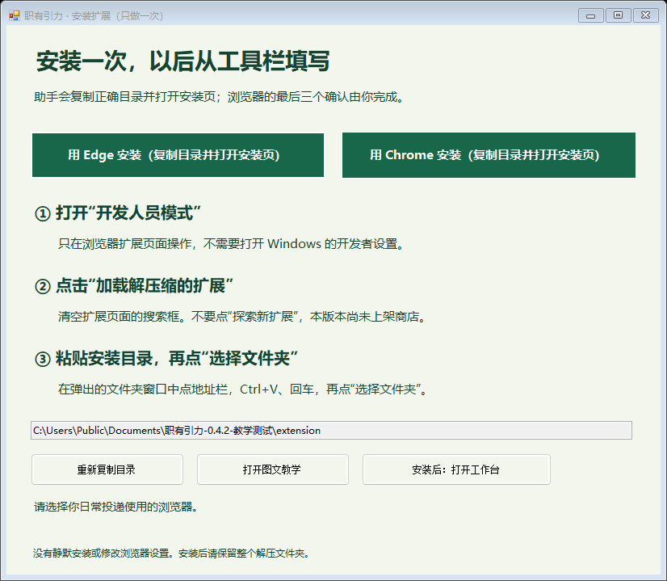

# 职有引力 · 求职工作台

中文优先、免费使用的求职工作台。采用 Build in Public，通过功能分支、Pull Request、独立审查和版本记录持续开发。

**当前版本：0.4.2 Beta（扩展版本号 0.4.2）。** 导入一次简历、确认一份档案，在不同招聘表单中复用。沿用既有源码，保留历史 v0.2.1 验收、招聘搜索、薪资、收藏、标签和投递管理。

### 普通 Windows 用户从这里开始

**[下载 Windows 完整包](https://github.com/Huamucuo/job-workbench-cn/releases/download/v0.4.2-beta.1/zhiyouyinli-windows-0.4.2-beta.1.zip)** · [下载页与校验值](https://github.com/Huamucuo/job-workbench-cn/releases/tag/v0.4.2-beta.1) · [图文教学 PDF](public/help/首次使用图文教学.pdf)

只下载这一个 ZIP，里面已有扩展、运行环境、虚构练习简历和离线图文教学。**不要把 Source code 当作普通用户安装包。** 全部解压 → 双击“开始使用.exe” → 第一次用“安装扩展.exe”完成浏览器要求的确认 → 导入、核对并保存。无需命令、软件账号、API 密钥或付费服务。默认免口令，资料保护可选。

安装助手把复制正确目录与打开 Edge/Chrome 扩展管理页合并为一次点击；浏览器仍要求本人开启开发人员模式、加载解压缩的扩展并选择文件夹，不会静默安装。包内“图文教学.html”和“图文教学.pdf”断网也能看。扩展尚未上架浏览器商店。

GitHub Actions 运行离线测试与源码构建，不部署网站或采集岗位。作者核验后通过 GitHub Release 分发 Windows Beta 软件。个人档案、真实岗位快照、浏览器资料、原始运行日志和宣传视频不进入源码仓库或下载包。

## 当前功能

- 有来源和核验状态的岗位搜索、多条件筛选、薪资口径与官方入口。
- 当前浏览器中的收藏、投递阶段、标签、备注、保存条件及私有备份。
- 本机统一求职档案，默认免口令、可选口令保护；导入 DOCX 和可提取文字的 PDF，预览、修订、处理冲突并确认保存。
- Chrome / Edge MV3 填表扩展：常驻侧栏保持本次档案授权，跨页、刷新、回退和同地址换步自动准备预览；逐页核对后填写，分类反馈和失败重试。原单页入口保留。
- 扩展持有唯一主档案。免口令档案直接在扩展中编辑；原口令档案经过逐页授权仍可由工作台共用。连接不会传送口令或明文简历，旧资料迁移需要明确选择来源。
- 学历与学位分开；多段教育、实习、工作、项目、技能、证书、语言与自我介绍均可编辑。描述版本只改变用户写入的职责与介绍文本。
- 本机附件保存与核验下载；可移植本机备份、可选加密备份、上一版恢复、独立恢复草稿、并发保存保护。
- 明确标注虚构的简历与 A/B/C/F 表单；分别检查页面值、受控模型值、保存值和模拟提交计数。

不自动投递、处理验证码、勾选声明或推进真实网页的下一步。填写后的网站可以立即读取输入，使用者必须本人核对。

## 安装与启动

普通 Windows 用户使用上方完整下载包：全部解压，双击 **开始使用.exe**，打开首页四个入口。首次扩展安装使用 **安装扩展.exe**，随后回工作台点击“检查安装是否完成”。详细教学同时包含在 ZIP 顶层，历史 [跨页填写说明](docs/beta/跨页填写说明.html) 继续保留。

安装助手会复制实际 **extension** 目录并打开 `edge://extensions` 或 `chrome://extensions`。清空搜索、开启开发人员模式、点击“加载解压缩的扩展”，在弹窗地址栏粘贴并选择文件夹。开发或测试浏览器里已加载不等于日常浏览器已安装。工作台检查当前浏览器的安装状态和版本，旧版会提示先备份再更新。

安装后回首页刷新，点击“导入简历”直接打开扩展档案；直接导入DOCX或文本PDF，不需口令，核对来源、歧义与冲突，点击一次“确认导入并保存”。日常在目标表单点击工具栏扩展 → 开始跨页填写 → 开始本次网申。仅开启口令保护时需解锁一次。后续每页自动准备预览；核对后点击“核对并填写本页”。无需重复批准网页连接；旧档案迁移或网页编辑共用档案时，才在首页折叠入口明确连接与选择来源。网站的下一步和最终提交均由本人操作。

维护者从源码运行：

安装 [Node.js](https://nodejs.org/) 24 或以上版本。浏览器依赖随源码提供，无需 npm install。在新下载的项目目录运行：

~~~text
npm run prepare:local
npm test
npm run build:extension
npm run package:extension
npm start
~~~

打开 http://127.0.0.1:47841 。Windows 源码完成初始化后，也可双击“开始使用.cmd”。初始化只创建缺失的本机文件，不覆盖已有数据。旧版继续使用原目录与 47831 端口，不会被 Beta 覆盖。

源码与 ZIP 没有附带未经许可的第三方岗位快照，初次岗位列表为空是预期行为。原电脑上既有的本机研究快照可以在独立发行目录 `.local/jobs.json` 保留；它不进 Git/ZIP，不改写发布时间、核验时间或状态。真实来源接入须另行审核许可、核验与采集频率，不把虚构表单当成真实岗位。

共享连接限定 `http://127.0.0.1:47841` 的指定顶层页面；每次刷新或新开工作台页面必须重新批准，授权有效 30 分钟并可撤销。选中共享档案后，断线不会悄悄改存另一份离线档案。免口令档案的本机访问资料仅允许扩展自身读取，不交给网页连接。默认免口令不能防止同一浏览器的其他使用者打开档案；可选口令保护当前有效档案，但保留的旧免口令版本和草稿仍在本机。

先用虚构样本演练“导入 → 预览 → 修改 → 确认保存 → 模拟表单 → 扩展识别 → 核对 → 填写”，不要向真实企业投递测试简历。

跨页操作与六页完整网申练习见 [跨页填写说明](docs/beta/跨页填写说明.html)。原0.4.0冻结发行目录保留；扩展需本人安装或更新，隔离测试不代表日常浏览器已更新。

## 验证与限制

0.4.1实测结果见 [跨页验收报告](docs/beta/跨页验收报告.html) 与 [维护测试说明](docs/TESTING.md)。[0.4.0 Beta验收报告](docs/beta/验收报告.html)保留历史结果，不能作为新增跨页能力的证据。历史 v0.3.0 共用引擎演练 46/46、v0.2.1 独立 37 项仍作为独立历史记录，不拿旧结果冒充新候选的运行证据。真人完整耗时对照已由用户明确免除；自动化耗时对照会报告实际方法、结果及限制，不承诺真人节时比例。

2026-10-12 对北森 iTalent 的只读结构检查没有输入或提交申请。Beta 对其相似的 Phoenix 选择器、邻近标签和 DIV 单选进行本机虚构复现，不能据此宣布真实站点全面兼容。Greenhouse、Ashby、北森及其他真实系统需要在具体页面由本人核对；最终实测范围和失败项见报告。

不支持扫描件 OCR、旧 DOC、加密 PDF；复杂排版、未标明的字段、需要推断的身份信息均保留待确认。iframe、Shadow DOM、任意自定义控件、文件上传、证件、声明及验证码保留人工处理。多级选择只接受受支持的控件结构和唯一明确的选项，不猜最高学历。描述版本不生成经历。附件最多 2 份、每份 512KiB，总原始数据 1MiB；加密前档案总内容上限 3MB。默认无需口令。开启口令保护后遗忘无法找回，请妥善保存；未加密备份含完整资料，请勿分享。

公开可访问的招聘接口不自动授予转载或持续采集权限；公开部署门禁保持关闭。

## 社区参与与许可

阅读 [路线图](ROADMAP.md)、[贡献指南](CONTRIBUTING.md)、[变更记录](CHANGELOG.md)、[开发流程](docs/DEVELOPMENT.md) 和 [SECURITY.md](SECURITY.md)。

有权授权的项目代码和文档沿用 [MIT](LICENSE)。PDF.js、fflate、Adobe CMaps、Foxit 和 Liberation 字体保留各自许可；Liberation 对应源码随源码和本机生成的分发包提供。详见 [第三方通知](THIRD_PARTY_NOTICES.md)。招聘内容和个人资料不获得项目 MIT 授权。
